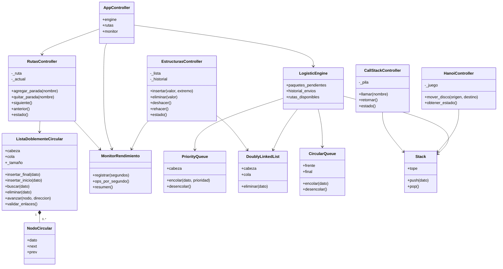

# Análisis técnico · Proyecto ED1 · Semana 3

## 1. Diseño MVC

- **Modelo (`estructuras/`, `modelos/`)**: almacenamiento manual con clases nodo y referencias (`next`, `prev`), cola circular, pila y cola de prioridad.
- **Lógica (`logica/`)**: motor de logística y medición. `MonitorRendimiento` registra operaciones y tiempos; `ejecutar_benchmark` emplea estructuras aisladas de los datos del usuario.
- **Controladores (`controlador/`)**: `AppController` y `RutasController` validan solicitudes, invocan modelos y generan representaciones para la interfaz.
- **Vistas (`vistas/`)**: Flet interpreta las instantáneas y dibuja tarjetas, vínculos, botones táctiles y paneles sin manipular `next`/`prev` de la ruta. Las vistas didácticas de lista, pila y Hanói acceden a estas estructuras a través de `EstructurasController`, `CallStackController` y `HanoiController`.
- **Persistencia**: SQLite conserva bitácoras de lista, llamadas y Hanói en modo local; con `ED1_DB_PATH=:memory:` es temporal por conexión/sesión.

## 2. Diagrama de clases (Mermaid)



## 3. Complejidad temporal y espacial

| Estructura | Operación | Tiempo | Espacio adicional | Explicación |
|---|---|---|---|---|
| Lista doble | insertar_inicio, insertar_final | **O(1)** | O(1) | Cabeza y cola accesibles directamente. |
| Lista doble | eliminar_inicio, eliminar_final | **O(1)** | O(1) | Ajusta uno o dos enlaces. |
| Lista doble | eliminar(dato) | **O(n)** | O(1) | Primero encuentra el nodo. |
| Lista doble circular | insertar_final, insertar_inicio | **O(1)** | O(1) | Actualiza `cabeza.prev` y `cola.next`. |
| Lista doble circular | avanzar/siguiente/anterior | **O(1)** | O(1) | Sigue un enlace; da la vuelta sin condición de fin. |
| Lista doble circular | buscar/eliminar(dato) | **O(n)** | O(1) | Recorrido acotado a `n` enlaces, evita bucle infinito. |
| Pila enlazada | push, pop, peek | **O(1)** | O(1) | Acceso al tope. |
| Cola prioridad ordenada | encolar | **O(n)** | O(1) | Encuentra la posición ordenada. |
| Cola prioridad ordenada | desencolar | **O(1)** | O(1) | Desacopla la cabeza. |
| Cola prioridad ordenada | eliminar_dato | **O(n)** | O(1) | Busca por identidad de objeto (undo). |
| Cola circular enlazada | encolar, desencolar | **O(1)** | O(1) | Mantiene `final.next=frente`. |

Cada nodo emplea O(1) espacio; almacenar n nodos ocupa **O(n)**. Las instantáneas para dibujar (`estado()`) generan arreglos *sólo para representación*, no como estructura de datos core. La lista circular doble conserva invariantes: `cola.next is cabeza`, `cabeza.prev is cola`, `next.prev is nodo` y `prev.next is nodo`.

## 4. Métricas

- **Operaciones/s**: contador de acciones del controlador en ventana móvil de 5 segundos dividido entre 5; refleja acciones del modelo por sesión y no fotogramas por segundo ni rendimiento total de CPU.
- **Duración**: `time.perf_counter()` rodea métodos de negocio del controlador; excluye parcialmente renderizado, transporte web y latencia de red.
- **Memoria**: `sys.getsizeof(nodo) + sys.getsizeof(dato)` estima objetos prototipo en CPython; no mide el heap completo, memoria de la interfaz, allocator, ni doble contabilización real de referencias.
- **Benchmark**: se construye una lista de N elementos con N inserciones O(1) y luego se ejecutan N búsquedas ausentes O(n). No son operaciones equivalentes semánticamente; el objetivo es ilustrar crecimiento temporal, no demostrar valores absolutos ni comparar microsegundos como garantía.
- **Prioridades**: se mantiene la convención del proyecto original, `1=Alta`, `2=Media`, `3=Baja` (menor número se despacha primero). Para empate la cola es estable FIFO.

## 5. Diagrama de enlaces

```text
Lista lineal:   None <- [A] <-> [B] <-> [C] -> None
Lista circular:        ┌───────────────────────┐
                  [A] <-> [B] <-> [C]
                        └───────────────────────┘
                    cabeza.prev=cola; cola.next=cabeza
Cola circular:  frente -> A -> B -> C --┐
                 ^-----------------------┘ final.next
```

## 6. Alcance multiplataforma

- Windows de 64 bits: ejecución en ventana local (`python main.py`) y construcción con `flet build windows` desde Windows.
- Web dinámica: `flet run --web main.py` en desarrollo; `python main.py` con `FLET_FORCE_WEB_SERVER=true` en un servidor. Requiere WebSockets habilitados.
- Android: interfaz adaptativa con botones táctiles, campos que se reordenan y navegación inferior. Construcción `flet build apk` en equipo con SDK/JDK; no se incluye APK precompilado.
- Win32 en la rúbrica se interpreta como ejecutable nativo de Windows. **Flet 1.0 actualmente empaqueta Python Windows x64, no un EXE de 32 bits**.

## 7. Pruebas automatizadas

`python -m pytest -q` cubre circularidad en ambas direcciones, eliminación cabeza/cola/intermedio, lista vacía y nodo único, cola de capacidad limitada, orden de prioridades, integridad de enlaces, deshacer en logística, controladores y métricas. Las pruebas de interacción de Flet, compilación Windows/Android y despliegue público deben ejecutarse en los entornos destino.
